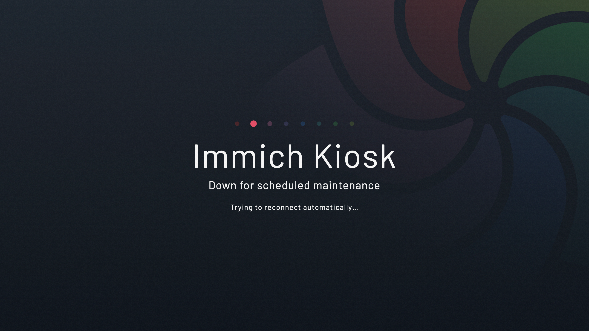
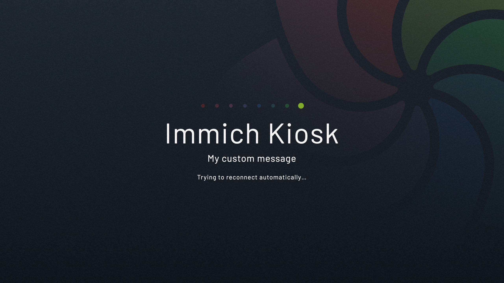

import { Code } from "@astrojs/starlight/components";

export const exampleConfig = `
#  Excluded the rest of the config for brevity

kiosk:
  maintenance_file: ./config/MAINTENANCE
`

export const exampleCompose = `
services:
  immich-kiosk:
    image: ghcr.io/damongolding/immich-kiosk:latest
    container_name: immich-kiosk
    environment:
      LANG: "en_GB"
      TZ: "Europe/London"
    ports:
       - 3000:3000
     volumes:
       - ./config:/config 
       # 👆 we will add the maintenance file to this mounted directory
     restart: always
     healthcheck:
       test: ["CMD", "/kiosk", "--healthcheck"]
       interval: 30s
       timeout: 5s
       retries: 3
       start_period: 10s
`

The `maintenance_file` allows you to add a message to the auto reconnect screen.

This might be useful if you want to let a user know that Kiosk is down intentionally.

Lets walk through the steps needed to add a message:

### 1. Make sure you mount a config directory (if using Docker)

Below is an example compose file that mounts `./config` into the container at the location `/config`.

<Code code={exampleCompose} lang="yaml" title="docker-compose.yaml" />

### 2. Tell Kiosk where to look for the file

Here's an example `config.yaml` file (which is also in `./config`). With this, Kiosk will be watching for a file called `MAINTENANCE` inside of the `config` directory.

<Code code={exampleConfig} lang="yaml" title="config.yaml" />


### 3. (A) Create the file

Lets create the file `MAINTENANCE` inside the `config` dir.

```sh
touch config/MAINTENANCE
```

Now when you stop Kiosk this is the screen the user will see.




### 3. (B) Create the file with a custom message

You can also add a custom message by adding it to the contents of the file.

```sh
echo "My custom message" > config/MAINTENANCE
```




### 4. Remove the file

Remove the file when Kiosk is back up and running.

```sh
rm config/MAINTENANCE
```
