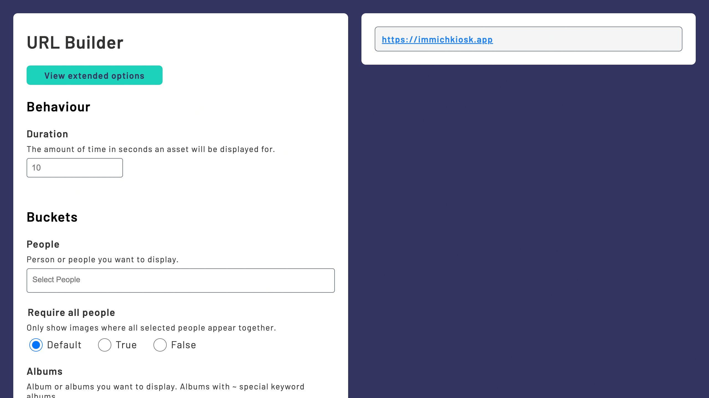

import { Code } from "@astrojs/starlight/components";

export const exampleConfig = `
#  Excluded the rest of the config for brevity

kiosk:
  enable_url_builder: true
`

export const exampleRedirectConfig = `
#  Excluded the rest of the config for brevity

redirects:
  items:
    - name: from-url-builder
      url: /?duration=60
`

You can use the URL builder to visually create redirect URLs.

### 1. Enable the `/url-builder` endpoint

<Code code={exampleConfig} lang="yaml" title="config.yaml" />

### 2. Navigate to the endpoint

Go to the `https://{KIOSK_URL}/url-builder` endpoint.

### 3. Add to redirects

Copy the output and add it to your redirects config

<Code code={exampleRedirectConfig} lang="yaml" title="config.yaml" />
